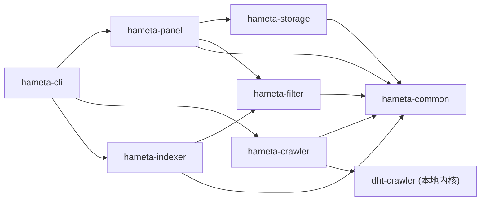
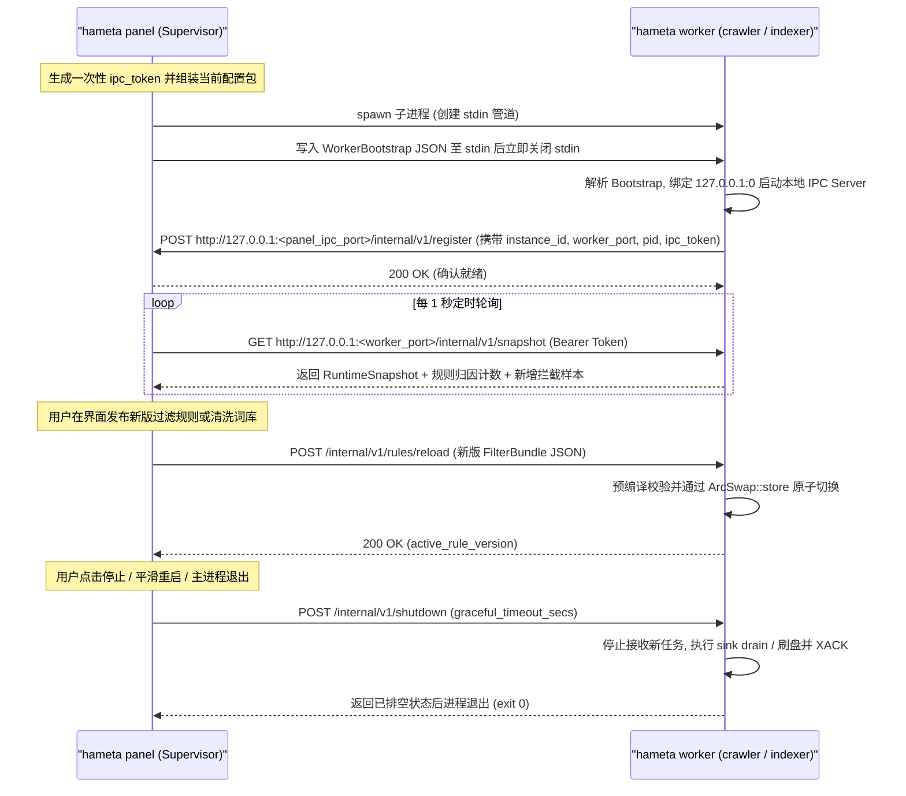

# hameta 系统详细架构与协议设计（Architecture & Spec）

- **关联需求文档**：[PRD.md](file:///g:/Development/Project/hameta/docs/PRD.md)（`v1.3`）
- **关联选型文档**：[TECH_STACK.md](file:///g:/Development/Project/hameta/docs/TECH_STACK.md)

---

## 1. Cargo Workspace 与工程目录结构

系统采用 7 个内聚 Crate 组成的 Cargo Workspace 加上独立 `web/` 前端目录，构建产物最终通过 `rust-embed` 汇入 `hameta-cli` 生成单一 `hameta` 可执行文件。

```text
hameta/
├── Cargo.toml                         # Workspace 根配置（Edition 2024，统一依赖版本）
├── Cargo.lock
├── docs/
│   ├── PRD.md
│   ├── TECH_STACK.md
│   ├── ARCHITECTURE.md
│   └── DEV_GUIDE.md
├── crates/
│   ├── hameta-common/                 # 共享契约：配置 Schema、密码/Token 哈希工具、IPC DTO、Redis/Manticore 公共类型、hash_to_id、日志工具
│   ├── hameta-filter/                 # 过滤与标题清洗引擎：6大类过滤、动态词库、ArcSwap热更新句柄、归因统计、试跑沙盒
│   ├── hameta-storage/                # SQLite 存储层：WAL初始化、迁移脚本、服务配置仓、时序降采样、版本与审计仓
│   ├── hameta-crawler/                # 采集 Worker：包装 dht-crawler、P1~P17 档位映射、Moka+Lua 去重、Streams 生产、IPC 服务
│   ├── hameta-indexer/                # 索引 Worker：Streams XREADGROUP/XACK/XAUTOCLAIM、批量缓冲、Manticore /bulk 写入、规则热重载
│   ├── hameta-panel/                  # 主控面板：Axum Web API、鉴权中间件、Supervisor 子进程守护、指标/日志聚合、前端嵌入
│   └── hameta-cli/                    # 二进制入口：clap 解析 panel / worker crawler / worker indexer / admin reset，初始化运行时
├── web/                               # Vue 3 + TypeScript + Vite SPA
│   ├── package.json
│   ├── pnpm-lock.yaml
│   ├── tsconfig.json
│   ├── vite.config.ts
│   ├── index.html
│   └── src/
│       ├── api/                       # 类型安全的 REST & SSE 客户端
│       ├── components/                # 通用布局、二次确认弹窗、CodeMirror 封装、图表组件
│       ├── router/                    # 路由与 Setup/Auth 导航守卫
│       ├── stores/                    # Pinia：session / system / overview 状态
│       ├── types/                     # TS 接口类型定义
│       └── views/                     # Setup / Login / Overview / Workers / FilterStudio / Redis / Explorer / Sql / Logs / Settings
└── deploy/                            # systemd 单元模板、Dockerfile、运维示例脚本
```

### Crate 依赖关系（严格有向无环）



---

## 2. SQLite 数据模型设计

`hameta.db` 存放于数据目录（默认 `./data/hameta.db`），**严格遵循单写者原则（仅 `hameta panel` 打开读写）**。

### 2.1 连接初始化 PRAGMA
每次打开连接池执行：
```sql
PRAGMA journal_mode = WAL;
PRAGMA synchronous = NORMAL;
PRAGMA busy_timeout = 5000;
PRAGMA foreign_keys = ON;
PRAGMA temp_store = MEMORY;
```

### 2.2 核心表结构 DDL（10 张表）

```sql
-- 1. 系统全局元信息（引导完成状态、安装实例 ID 等）
CREATE TABLE IF NOT EXISTS system_meta (
    key         TEXT PRIMARY KEY,
    value       TEXT NOT NULL,
    updated_at  INTEGER NOT NULL
);

-- 2. 管理员账号
CREATE TABLE IF NOT EXISTS admin_users (
    id              INTEGER PRIMARY KEY AUTOINCREMENT,
    username        TEXT NOT NULL UNIQUE,
    password_hash   TEXT NOT NULL,          -- 加盐 SHA-256 哈希（salt$hex）
    created_at      INTEGER NOT NULL,
    updated_at      INTEGER NOT NULL,
    last_login_at   INTEGER
);

-- 3. 登录会话（服务端只存随机 Token 的 SHA-256 摘要）
CREATE TABLE IF NOT EXISTS admin_sessions (
    token_hash      TEXT PRIMARY KEY,
    user_id         INTEGER NOT NULL REFERENCES admin_users(id) ON DELETE CASCADE,
    client_ip       TEXT NOT NULL,
    user_agent      TEXT NOT NULL DEFAULT '',
    created_at      INTEGER NOT NULL,
    expires_at      INTEGER NOT NULL,
    last_seen_at    INTEGER NOT NULL
);
CREATE INDEX IF NOT EXISTS idx_admin_sessions_expires ON admin_sessions(expires_at);

-- 4. 服务连接配置版本表（Redis 与 Manticore 配置统一版本化）
-- kind: 'redis' | 'manticore'
CREATE TABLE IF NOT EXISTS service_configs (
    id                  INTEGER PRIMARY KEY AUTOINCREMENT,
    kind                TEXT NOT NULL CHECK (kind IN ('redis', 'manticore')),
    version             INTEGER NOT NULL,
    config_json         TEXT NOT NULL,      -- 完整配置 JSON（含 Redis / Manticore 连接与密码，本地明文存储）
    is_active           INTEGER NOT NULL DEFAULT 0,
    last_test_ok        INTEGER,            -- NULL 未测试, 1 成功, 0 失败
    last_test_message   TEXT,
    last_tested_at      INTEGER,
    created_by          TEXT NOT NULL,
    note                TEXT NOT NULL DEFAULT '',
    created_at          INTEGER NOT NULL,
    UNIQUE (kind, version)
);
CREATE INDEX IF NOT EXISTS idx_service_configs_active ON service_configs(kind, is_active);

-- 5. Worker 实例注册与守护策略表
-- role: 'crawler' | 'indexer'
-- desired_state: 'stopped' | 'running'
CREATE TABLE IF NOT EXISTS worker_instances (
    id                      TEXT PRIMARY KEY,           -- 如 'crawler-1', 'indexer-1'
    role                    TEXT NOT NULL CHECK (role IN ('crawler', 'indexer')),
    display_name            TEXT NOT NULL,
    desired_state           TEXT NOT NULL DEFAULT 'stopped' CHECK (desired_state IN ('stopped', 'running')),
    active_config_version   INTEGER NOT NULL DEFAULT 1,
    auto_restart            INTEGER NOT NULL DEFAULT 1, -- 崩溃后是否自动重启
    max_restarts            INTEGER NOT NULL DEFAULT 5, -- 连续快速崩溃熔断上限
    restart_backoff_secs    INTEGER NOT NULL DEFAULT 3, -- 指数退避基数
    created_at              INTEGER NOT NULL,
    updated_at              INTEGER NOT NULL
);

-- 6. Worker 实例配置版本表（支持历史 Diff 与一键回滚）
CREATE TABLE IF NOT EXISTS worker_config_versions (
    id              INTEGER PRIMARY KEY AUTOINCREMENT,
    instance_id     TEXT NOT NULL REFERENCES worker_instances(id) ON DELETE CASCADE,
    version         INTEGER NOT NULL,
    config_json     TEXT NOT NULL,      -- crawler L1/L2/L3 完整配置或 indexer 并发/批处理配置
    created_by      TEXT NOT NULL,
    note            TEXT NOT NULL DEFAULT '',
    created_at      INTEGER NOT NULL,
    UNIQUE (instance_id, version)
);

-- 7. 过滤规则与清洗词库版本表（草稿 + 线上发布版本）
-- status: 'draft' | 'published' | 'archived'
CREATE TABLE IF NOT EXISTS filter_rule_versions (
    id              INTEGER PRIMARY KEY AUTOINCREMENT,
    version         INTEGER NOT NULL UNIQUE,
    status          TEXT NOT NULL CHECK (status IN ('draft', 'published', 'archived')),
    filter_json     TEXT NOT NULL,      -- 6 大类规则 JSON（每条带 rule_id, enabled, note）
    ad_phrases_json TEXT NOT NULL,      -- 动态广告短语列表 JSON（带 id, phrase, enabled, note）
    ad_regexes_json TEXT NOT NULL,      -- 动态广告正则列表 JSON（带 id, pattern, enabled, note）
    created_by      TEXT NOT NULL,
    note            TEXT NOT NULL DEFAULT '',
    created_at      INTEGER NOT NULL,
    published_at    INTEGER
);
CREATE INDEX IF NOT EXISTS idx_filter_versions_status ON filter_rule_versions(status);

-- 8. 分钟级持久化历史指标表（默认保留 7 天，约 10,080 行/系统）
CREATE TABLE IF NOT EXISTS metrics_minute (
    ts_minute                   INTEGER PRIMARY KEY,    -- 对齐到整分钟 Unix 秒
    hashes_per_min              REAL NOT NULL,
    metadata_succeeded_per_min  REAL NOT NULL,
    stream_pushed_per_min       REAL NOT NULL,
    filtered_per_min            REAL NOT NULL,
    indexed_written_per_min     REAL NOT NULL,
    hot_updated_per_min         REAL NOT NULL,
    actual_qps                  REAL NOT NULL,
    stream_new_len              INTEGER NOT NULL,
    stream_hot_len              INTEGER NOT NULL,
    stream_new_lag              INTEGER NOT NULL,
    udp_rx_bps                  REAL NOT NULL,
    udp_tx_bps                  REAL NOT NULL,
    metadata_rx_bps             REAL NOT NULL,
    total_rss_bytes             INTEGER NOT NULL,
    avg_cpu_percent             REAL NOT NULL
);

-- 9. 小时级持久化历史指标表（默认保留 90 天以上）
CREATE TABLE IF NOT EXISTS metrics_hour (
    ts_hour                     INTEGER PRIMARY KEY,    -- 对齐到整小时 Unix 秒
    hashes_total                INTEGER NOT NULL,
    metadata_succeeded_total    INTEGER NOT NULL,
    stream_pushed_total         INTEGER NOT NULL,
    filtered_total              INTEGER NOT NULL,
    indexed_written_total       INTEGER NOT NULL,
    hot_updated_total           INTEGER NOT NULL,
    avg_qps                     REAL NOT NULL,
    max_stream_new_lag          INTEGER NOT NULL,
    avg_rss_bytes               INTEGER NOT NULL
);

-- 10. 操作审计日志
CREATE TABLE IF NOT EXISTS audit_logs (
    id          INTEGER PRIMARY KEY AUTOINCREMENT,
    actor       TEXT NOT NULL,
    action      TEXT NOT NULL,          -- 如 'settings.redis.update', 'filter.publish', 'torrent.delete'
    target      TEXT NOT NULL DEFAULT '',
    detail_json TEXT NOT NULL DEFAULT '{}',
    client_ip   TEXT NOT NULL DEFAULT '',
    created_at  INTEGER NOT NULL
);
CREATE INDEX IF NOT EXISTS idx_audit_logs_created ON audit_logs(created_at DESC);
```

### 2.3 本地数据与密码存储说明
- 管理员登录密码使用随机盐 + `SHA-256` 哈希（`salt$hex`）存储于 `admin_users.password_hash`。
- Redis 与 Manticore 连接配置（含密码）直接以明文 JSON 存放在本地 `service_configs.config_json` 中，无需维护主密钥文件，通过宿主机文件系统权限保护 `hameta.db` 即可。

---

## 3. Redis 数据契约与 Streams 协议

### 3.1 Key 命名空间规范

| Key 模式 | 类型 | 所属规范 | TTL / 容量策略 | 用途说明 |
|---|---|---|---|---|
| `metadata:indexed:<info_hash>` | `String` (`"1"`) | **兼容存量** | 永久（可手动清理） | 全局已入库标记；`crawler` 发现时命中直接跳过或转投热度流；`indexer` 确认 Manticore 写入成功后置位 |
| `hameta:lock:pending:<info_hash>` | `String` (`<token>`) | `hameta` 新规范 | 默认 `3600s`，失败退避 `60s` | 多 `crawler` 并发抓取租约锁，携带 fencing token 防并发乱序覆盖 |
| `hameta:lock:rejected:<info_hash>` | `String` (`<size>`) | `hameta` 新规范 | `86400s` (24h) | 超出 `max_message_size` 的策略拒绝缓存，避免重复下载超大种子 |
| `hameta:lock:delivery:<info_hash>:<token>` | `String` (`<token>`) | `hameta` 新规范 | `3600s` | `XADD` 投递幂等凭证，防止网络超时的重试产生重复消息 |
| `hameta:stream:torrent:new` | `Stream` | `hameta` 新规范 | `MAXLEN ~ 3000000` | 新抓取待过滤入库的种子元数据流 |
| `hameta:stream:torrent:hot` | `Stream` | `hameta` 新规范 | `MAXLEN ~ 3000000` | 已入库种子的热度增量流 |
| Consumer Group `hameta:cg:indexer` | `Group` | `hameta` 新规范 | 跟随 Stream | `indexer` 消费者组，消费者名格式 `<instance_id>-<pid>` |

### 3.2 Stream 消息体规范

1. **`hameta:stream:torrent:new`**（Fields）：
   - `info_hash`: 40 位小写十六进制字符串
   - `payload`: JSON 字符串，结构与 `TorrentMessage` 对齐：
     ```json
     {
       "info_hash": "0123456789abcdef0123456789abcdef01234567",
       "name": "example",
       "total_size": 1048576,
       "file_count": 1,
       "files": [{ "path": "example.bin", "size": 1048576 }],
       "timestamp": 1784428800
     }
     ```
2. **`hameta:stream:torrent:hot`**（Fields）：
   - `info_hash`: 40 位小写十六进制字符串
   - `timestamp`: Unix 秒级时间戳字符串

### 3.3 原子 Lua 脚本契约（`crawler` 侧）
沿用并发安全设计，4 个核心 Lua 脚本全部通过 `EVALSHA` 原子执行：
1. **`CLAIM_METADATA_SCRIPT`**：检查 `metadata:indexed:<hash>` → 检查 `hameta:lock:rejected:<hash>` → 原子 `SET hameta:lock:pending:<hash> <token> NX EX <ttl>`；返回 `{0, 0}` 允许抓取，或返回已索引/被占用/拒绝状态及剩余 PTTL。
2. **`PUBLISH_TORRENT_STREAM_SCRIPT`**：校验 `delivery` 幂等键、确认未索引且 `pending` 租约仍归本 `token` 所有（或允许 fail-open 补写）后，原子执行 `XADD hameta:stream:torrent:new MAXLEN ~ <max_len> * info_hash <hash> payload <json>`，并置位 `delivery` 幂等键。
3. **`RELEASE_CLAIMS_SCRIPT`**：仅当 `pending` 值仍等于当前 `token` 时才删除或设置为失败退避 `PEXPIRE`，防止过期任务误删新占有者的锁。
4. **`REJECT_OVERSIZE_SCRIPT`**：当消息序列化后超过 `max_message_size`，原子写入 `hameta:lock:rejected:<hash>` 并清理本人持有的 `pending` 锁。

### 3.4 `indexer` 消费与崩溃接管流
1. **启动就绪**：对两个 Stream 执行 `XGROUP CREATE <stream> hameta:cg:indexer 0 MKSTREAM`（忽略 `BUSYGROUP`）。
2. **主循环读取**：每个消费协程执行 `XREADGROUP GROUP hameta:cg:indexer <consumer> COUNT <read_batch_size> BLOCK <read_block_ms> STREAMS <stream> >`。
3. **内存批量与严格 Ack**：
   - 将拉取到的 `new` 消息送入当前 `ArcSwap` 过滤器与清洗器：
     - **被过滤拦截的条目**：记录规则归因计数与拦截样本环形缓冲，收集其 Stream Entry ID，**立即批量 `XACK`**（无需等 Manticore 写库）。
     - **通过过滤的条目**：附带其 `(Stream Entry ID, TorrentRecord)` 进入 `TorrentBatcher`；当 Manticore `/bulk` 严格回执验证成功且 Redis `metadata:indexed:<hash>` 置位（同步 `DEL hameta:lock:pending:<hash>`）后，**立即对该批次对应的所有 Entry ID 执行批量 `XACK`**。
   - 若 Manticore 写入失败，**绝不执行 `XACK`**，进入退避重试或等待后续 `XAUTOCLAIM` 接管。
4. **PEL 自动接管（防崩溃丢消息）**：
   - 后台定时任务（默认每 30 秒）对两个 Stream 扫描空闲超过 `min_idle_ms`（如 120 秒）的未确认消息：
     - Redis `>= 6.2`：优先使用 `XAUTOCLAIM <stream> hameta:cg:indexer <consumer> 120000 0-0 COUNT 256`。
     - Redis `5.0–6.0`：自动回退使用 `XPENDING` + `XCLAIM`。
   - 对投递次数超过阈值（如 `delivery_count > 5`）的“毒丸消息”（如无法解析的损坏 JSON），记录 `ERROR` 级别日志及样本后执行 `XACK` 避免永久阻塞队列。

---

## 4. Manticore 存量兼容与查询保护设计

### 4.1 `torrents` 表锁定契约与校验
1. 表名常量：`TABLE_TORRENTS = "torrents"`，绝对禁止任何 `ALTER` / `DROP`。
2. 预期字段与类型核验列表（连接 Manticore 执行 `DESCRIBE torrents`）：
   - `id` / `info_hash` / `raw_name` / `refine_name` / `file_count` / `file_info` / `hot` / `created_at` / `updated_at`。
3. 仅当表不存在时，由初始化向导或服务配置中心经用户显式点击“初始化建表”执行：
   ```sql
   CREATE TABLE IF NOT EXISTS torrents (
       info_hash string,
       raw_name text,
       refine_name text,
       file_count int,
       file_info json,
       hot int,
       created_at timestamp,
       updated_at timestamp
   ) engine='columnar' ngram_len='1' ngram_chars='cjk'
   ```

### 4.2 63-bit 确定性 ID 算法
```rust
pub fn hash_to_id(info_hash: &str) -> i64 {
    if info_hash.len() < 16 {
        return 0;
    }
    match u64::from_str_radix(&info_hash[..16], 16) {
        Ok(v) => (v & 0x7FFF_FFFF_FFFF_FFFF) as i64,
        Err(_) => 0,
    }
}
```

### 4.3 `/bulk` 严格回执校验不变量
沿用并强化 `manticore.rs` 验证状态机：
- 必须返回完整可解析 JSON 且 `errors == false`、顶层 `error` 为空。
- 若存在 `skipped_lines`，必须为 `0`；若存在 `current_line`，必须严格推进到操作数之后（`> operations`）。
- 兼容 Manticore 分组事务回执（`items` 内单条 `bulk` 汇总 `created + updated`）和逐条回执（`items.len() == operations`）；只有确认写入数与提交批次数完全吻合，才允许返回 `Ok`。

### 4.4 海量存量查询保护策略
1. **总览库容量统计**：优先使用 `SHOW TABLE torrents STATUS` 获取 `indexed_documents` 与磁盘占用，服务端缓存 60 秒；禁止页面刷新触发全表 `SUM(...)` 扫描。“今日新增”优先取面板对 `indexer` 上报成功写入量的增量汇总。
2. **检索与列表限流**：`/api/v1/torrents` 强制 `pageSize` 区间 `5..=100`，`page` 深度过大（如超过 1000 页）建议使用游标或收敛检索条件。
3. **只读 SQL 控制台安全防线**：
   - 仅放行单条以 `SELECT` / `SHOW` / `DESCRIBE` / `DESC` / `EXPLAIN` 开头的查询（剥离前导空白与注释校验），拒绝含分号分隔的多语句与写关键字（`INSERT`/`REPLACE`/`UPDATE`/`DELETE`/`DROP`/`ALTER`/`TRUNCATE`）。
   - 对于未显式携带 `LIMIT` 的 `SELECT` 语句，服务端自动注入 `LIMIT 200`（上限不超过 `1000`），且设置独立 HTTP 读超时（如 `10s`）。

---

## 5. 多进程守护与 Loopback IPC 协议

### 5.1 生命周期与通信时序



### 5.2 防孤儿进程与崩溃自愈策略
- **OS 级父子绑定**：
  - **Linux**：在子进程 `pre_exec` 钩子中调用 `libc::prctl(libc::PR_SET_PDEATHSIG, libc::SIGTERM)`，确保 `panel` 即使被 `kill -9` 杀死，内核也会自动向所有 Worker 发送 `SIGTERM`。
  - **Windows**：创建 Win32 Job Object 并设置 `JOB_OBJECT_LIMIT_KILL_ON_JOB_CLOSE`，将启动的子进程句柄加入该 Job；当 `panel` 进程句柄销毁时操作系统自动终止所有子进程。
- **崩溃自愈与熔断**：
  - Supervisor 通过 `child.wait()` 异步监听子进程退出，读取最后 64 KB 的 stderr 缓冲区存入告警摘要。
  - 若 `desired_state == 'running'` 且非主动停机导致非零退出，且 `auto_restart == 1`：按照 `restart_backoff_secs * 2^(fail_streak - 1)` 退避重启；若连续在 60 秒内快速崩溃达到 `max_restarts` 次，则触发熔断标记为 `Crashed`，停止自动重启并在 Web 顶部强提示运维介入。

### 5.3 Loopback IPC 路由表（`127.0.0.1`，均需 `Authorization: Bearer <token>`）

| 方向 | Method & Path | 用途 |
|---|---|---|
| Worker → Panel | `POST /internal/v1/register` | 子进程启动后上报自身监听端口、PID 与实例确认 |
| Worker → Panel | `POST /internal/v1/ready` | 子进程完成 Redis/Manticore/DHT 初始化并开始提供服务 |
| Panel → Worker | `GET /internal/v1/snapshot` | 拉取当前毫秒级运行时快照、通道/批次指标、规则命中增量与新拦截样本 |
| Panel → Worker | `POST /internal/v1/rules/reload` | 推送最新过滤规则与清洗词库（仅 `indexer`），校验后 `ArcSwap` 原子切换 |
| Panel → Worker | `GET /internal/v1/drain-status` | 停机过程中轮询 `sink drain` 或刷盘排空进度 |
| Panel → Worker | `POST /internal/v1/shutdown` | 触发优雅停机并设定排空超时 |

---

## 6. Web REST API 与 SSE 接口设计总览

### 6.1 响应规范与鉴权中间件
- **统一响应结构**：成功返回标准 JSON 数据（列表包含 `{ items, total, page, page_size }`）；错误统一返回 HTTP 4xx/5xx + `{ "code": "<ERROR_CODE>", "message": "<人类可读中文说明>", "detail": "<可选技术细节>" }`。
- **鉴权与引导路由守卫**：
  - 公开免登录端点：`/healthz`、`/api/v1/setup/status`、`/api/v1/setup/init`（仅未初始化时开放，初始化完成后返回 `403`）、`/api/v1/setup/test-redis`（仅未初始化时开放）、`/api/v1/setup/test-manticore`（仅未初始化时开放）、`/api/v1/auth/login`。
  - 其余 `/api/v1/*` 与 `/metrics`（可配置是否受保护或绑定独立内网地址）均需验证 `hameta_session` HttpOnly Cookie。

### 6.2 核心路由矩阵

| 模块 | Method & Path | 功能描述 |
|---|---|---|
| **引导与认证** | `GET /api/v1/setup/status` | 返回是否已完成初始化及兼容状态 |
| | `POST /api/v1/setup/test-redis` | 引导阶段测试 Redis 连通、版本与权限 |
| | `POST /api/v1/setup/test-manticore` | 引导阶段测试 Manticore 并 `DESCRIBE torrents` |
| | `POST /api/v1/setup/init` | 原子创建管理员、保存服务配置、写入默认实例与线上过滤基线 |
| | `POST /api/v1/auth/login` / `logout` / `password` | 登录（带 IP 限流）、登出、修改当前管理员密码 |
| | `GET /api/v1/auth/me` | 获取当前登录态与会话摘要 |
| **服务配置中心** | `GET /api/v1/settings/services` | 获取当前 Redis 与 Manticore 配置（含密码在内全部字段完整回显）及版本号 |
| | `POST /api/v1/settings/redis/test` | 使用表单或已保存连接配置测试 Redis 连接、延迟、版本与内存 |
| | `PUT /api/v1/settings/redis` | 保存新版 Redis 配置，支持参数 `restart_affected_workers` 联动滚动重启 |
| | `POST /api/v1/settings/manticore/test` | 测试 Manticore HTTP/BasicAuth 并校验 `torrents` 表字段 |
| | `POST /api/v1/settings/manticore/init-table` | 仅当空库无表时显式创建 `torrents` 表 |
| | `PUT /api/v1/settings/manticore` | 保存新版 Manticore 配置，支持联动滚动重启受影响 `indexer` |
| | `GET /api/v1/settings/history` / `POST .../rollback` | 查看服务配置历史版本并一键回滚 |
| **总览仪表盘** | `GET /api/v1/overview/snapshot` | 全局全链路漏斗、进程健康、KPI 卡片与主机资源快照 |
| | `GET /api/v1/overview/history?range=1h\|6h\|24h\|7d\|30d` | 查询 SQLite / 内存缓冲的秒/分/小时降采样趋势数据 |
| | `GET /api/v1/overview/stream` | SSE 实时推送每秒全局汇总快照 |
| **进程与参数管理** | `GET /api/v1/workers` | 列出所有 `crawler` / `indexer` 实例状态、PID、重启次数、排空进度 |
| | `POST /api/v1/workers` / `DELETE /api/v1/workers/:id` | 新增或删除 Worker 实例（运行中禁止直接删除） |
| | `POST /api/v1/workers/:id/start` / `stop` / `restart` | 启动、优雅停机、平滑重启指定实例 |
| | `GET /api/v1/workers/:id/config` | 获取当前 L1/L2/L3 采集配置（或索引配置）及所属档位默认值 |
| | `PUT /api/v1/workers/:id/config` | 校验并保存新配置版本，支持 `apply_restart: bool` 平滑重启生效 |
| | `GET /api/v1/workers/:id/config/versions` / `POST .../rollback` | 查看历史配置版本 Diff 与一键回滚 |
| | `GET /api/v1/workers/:id/diagnostics` | 获取单个 `crawler` 深度 DHT 诊断（分阶段超时/连接错误/来源收益/直方图）或 `indexer` 吞吐细节 |
| | `GET /api/v1/dht/profiles` | 获取 `P1`–`P17` 完整档位参数对照表与本机 `ulimit -n` 检测结果 |
| **过滤清洗工作台** | `GET /api/v1/filter/state` | 获取当前线上已发布版本与草稿版本的 6 大类规则 + 动态清洗词库 |
| | `PUT /api/v1/filter/draft` | 保存草稿（保存前强制正则预编译校验，返回精确语法错误位置） |
| | `POST /api/v1/filter/publish` | 发布草稿为新线上版本并向所有在线 `indexer` 广播热更新 |
| | `GET /api/v1/filter/versions` / `POST .../rollback` | 历史规则版本列表与回滚热更新 |
| | `GET /api/v1/filter/stats` | 各规则近 24h/累计命中拦截排行榜与最近 200 条被拦截样本摘要 |
| | `POST /api/v1/filter/playground/test` | 单条或批量试跑（支持选择 `draft` / `published` / `ab_compare` 模式） |
| | `POST /api/v1/filter/playground/sample` | 从 Manticore 存量随机/最新抽样或提取近期拦截样本加载至沙盒 |
| **Redis 监控与诊断** | `GET /api/v1/redis/overview` | Redis 内存、连接池使用、延迟 P50/P95、双 Stream 长度/Lag/PEL 状态 |
| | `GET /api/v1/redis/streams/:name/preview` | 预览 Stream 队尾最近 N 条消息摘要 |
| | `POST /api/v1/redis/streams/:name/trim` | 受控修剪 Stream 长度（高危，需二次确认） |
| | `GET /api/v1/redis/hash/:info_hash` | 单 Hash 诊断（查 Redis `indexed`/`pending`/`rejected` + Manticore 存在性） |
| | `DELETE /api/v1/redis/hash/:info_hash/locks` | 清理指定 Hash 的 `pending`/`rejected`/`indexed` 锁标记 |
| **磁力浏览与 SQL** | `GET /api/v1/torrents` | 全文检索 / InfoHash 匹配 / 多维度筛选排序分页（`pageSize <= 100`） |
| | `GET /api/v1/torrents/:id` / `POST /api/v1/torrents` / `PATCH /api/v1/torrents/:id` | 详情、手动新增、修订标题/热度/文件列表 |
| | `DELETE /api/v1/torrents/:id` / `POST /api/v1/torrents/batch-delete` | 单条或批量删除，支持参数 `keep_redis_indexed: bool`（默认 `true`） |
| | `POST /api/v1/sql/query` | 执行只读 SQL（`SELECT`/`SHOW`/`DESCRIBE`/`DESC`/`EXPLAIN`），自动 `LIMIT` 防护 |
| **日志与生态** | `GET /api/v1/logs/stream?target=...&level=...` | SSE 实时尾流日志（支持 `panel` 或任意 `worker_id`） |
| | `GET /api/v1/logs/files` / `GET /api/v1/logs/download` | 列出与下载历史按天日志文件 |
| | `GET /healthz` / `GET /metrics` | 存活就绪检查 / 聚合 Prometheus 指标端点 |

### 6.3 CLI 运维命令规范

```bash
# 重置（或创建）管理员账号与密码（支持面板未启动或运行中 WAL 模式下直接执行）
hameta admin reset --username <new_user> --password <new_pass> [--data-dir ./data]
```
- **行为契约**：
  1. 校验用户名与密码非空，打开指定 `--data-dir` 下的 `hameta.db`（WAL + `busy_timeout = 5000`）。
  2. 在单事务内以新的随机盐 + `SHA-256` 更新（或插入）`admin_users` 唯一管理员记录，同时清空 `admin_sessions` 表强制所有已登录终端下线重新登录。
  3. 向 `audit_logs` 写入一条 `actor = "cli"`、`action = "admin.reset"` 的审计记录（不记录密码明文），输出重置成功提示并退出 `0`。

---

## 7. 过滤清洗引擎与沙盒热更新内部设计

### 7.1 `hameta-filter` 核心结构
- **`CompiledFilterEngine`**：
  - 内含 `version: u64`、`FilterRuleSet`（6 大类规则，每条赋予唯一 `rule_id`、名称、启用标记）与 `TitleCleaner`（动态 `ad_phrases`、`ad_regexes` 与内置 `iana_tlds`）。
  - 在 `indexer` 内部以 `Arc<ArcSwap<CompiledFilterEngine>>` 持有；每条消息消费前调用 `.load()` 获取轻量 `Guard`，消费过程中绝不阻塞规则热更新。
- **精确归因与样本缓冲**：
  - 提供 `evaluate_with_trace(&TorrentMessage) -> FilterEvaluation` 方法：不仅返回 `Accepted(refined_name)` 或 `Rejected`，还在拦截时精确返回 `RuleHit { category, rule_id, rule_label, detail }`。
  - 内存中以 `Mutex<VecDeque<RejectedSample>>` 维护容量上限 `200` 的环形缓冲，记录被拦截种子的摘要、时间戳与命中原因，随每秒 IPC 快照增量或按需回传给 `panel`。
- **草稿 A/B 对比流程**：
  - `panel` 接收 `/api/v1/filter/playground/test` 请求后，在本地内存基于提交的草稿 JSON 临时编译 `draft_engine`（若任意正则编译失败立即返回精确报错字段与原因），同时与当前 `published_engine` 对同一组样本分别执行 `evaluate_with_trace` 和分步清洗轨迹对比，输出“清洗结果变化”与“拦截/放行翻转列表”。
