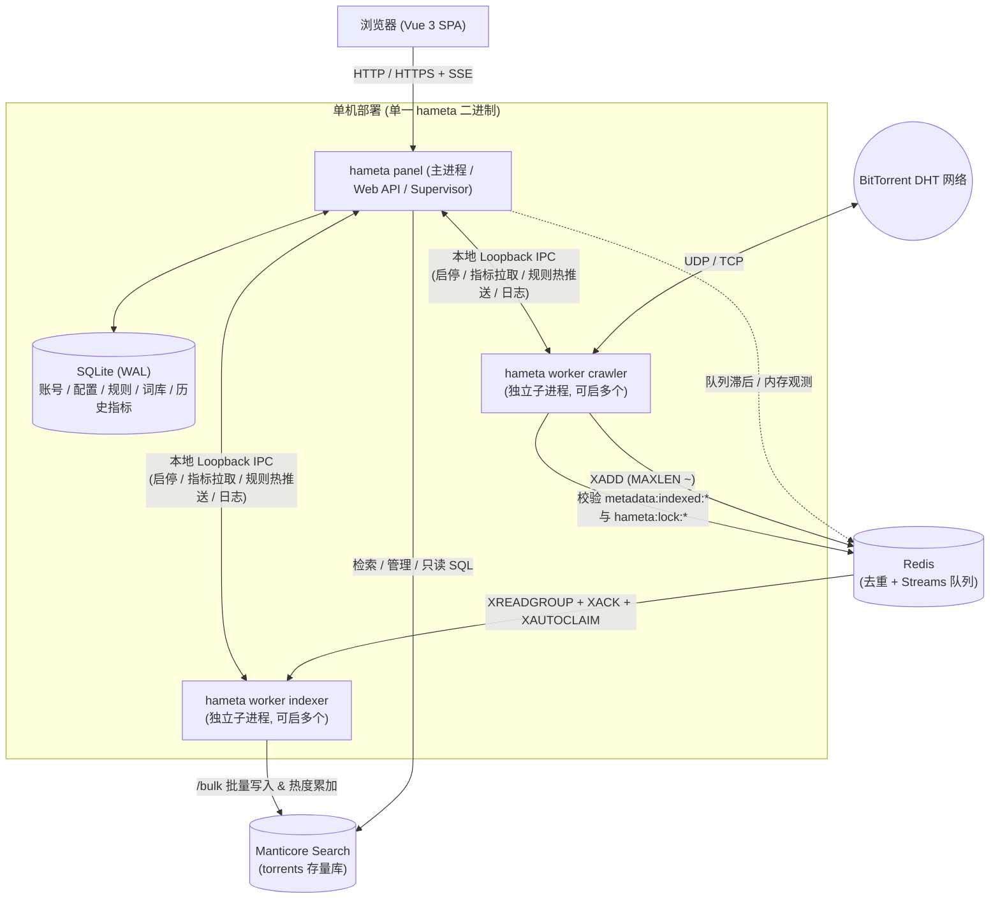

# hameta — DHT-Hash Web 运维与检索面板需求规格说明书

- **项目名称**：`hameta`
- **文档版本**：`v1.3`
- **文档状态**：迭代更新中
- **核心依赖内核**：[dht-crawler](file:///G:/Development/Project/Rust%E7%A3%81%E5%8A%9B%E7%88%AC%E8%99%AB/dht-crawler) (`v0.2.1`)
- **参考前代实现**：`crawler-node`、`torrent-indexer`、`torrent-browser`（均在本次重构中淘汰，仅参考其成熟逻辑与数据契约）

---

## 1. 项目背景与不可违背的数据保护红线

### 1.1 项目背景与目标
为了取代分散的 CLI 采集节点（`crawler-node`）、CLI 索引器（`torrent-indexer`）以及独立前端浏览器（`torrent-browser`），本项目将在 `hameta` 中使用 **Rust 后端 + Vue 3 前端（单二进制交付）** 全新构建一套友好、成熟、高可用的 DHT-Hash Web 运维与自用磁力检索面板。

系统定位为**纯后台运维与自用检索面板**（统一登录后使用），核心解决以下痛点：
1. **故障隔离与可控性**：从只能看只读看板/终端 TUI，升级为单机多进程守护托管，支持在线启停、平滑重启、档位调优、规则热更新。
2. **全链路可观测**：打通 `DHT 采集 → Redis 去重与消息队列 → 过滤与标题清洗 → Manticore 入库与热度累加` 全链路监控与排障。
3. **平滑接管存量资产**：无缝衔接线上已在运行的 Redis 去重状态与海量 Manticore Search 存量数据。

### 1.2 不可违背的兼容性与数据保护红线

#### A. Manticore Search 存量结构与数据保护红线
Manticore Search 线上已沉淀大量真实磁力数据，以下规则属于最高优先级约束：
1. **表结构绝对冻结**：
   - 表名固定为 `torrents`，**严禁**执行任何 `ALTER TABLE`、`DROP TABLE`、`TRUNCATE` 或破坏性结构变更。
   - 字段与类型完全锁定如下：
     - `id` (`bigint`，63-bit 确定性主键)
     - `info_hash` (`string`)
     - `raw_name` (`text`)
     - `refine_name` (`text`)
     - `file_count` (`int`)
     - `file_info` (`json`，JSON 字符串数组，元素结构为 `{"path": string, "size": u64}`)
     - `hot` (`int`)
     - `created_at` (`timestamp`)
     - `updated_at` (`timestamp`)
   - 建表参数锁定为 `engine='columnar' ngram_len='1' ngram_chars='cjk'`。
   - 连接已有 Manticore 实例时，仅执行 `DESCRIBE torrents` 校验字段存在性与兼容性；**仅在全新空库中 `torrents` 表不存在时**，才执行 `CREATE TABLE IF NOT EXISTS`。
2. **确定性文档 ID 算法锁定**：
   - 严格沿用既有 63-bit 算法 `hash_to_id(info_hash)`：校验并截取 40 位十六进制 `info_hash` 的前 16 个字符（64 bits），解析为 `u64` 后与 `0x7FFF_FFFF_FFFF_FFFF` 按位与，转为正数 `i64`。确保历史数据与新增数据的 `id` 映射完全一致，防止写入重复文档或 ID 错位。
3. **严格写库回执校验**：
   - 批量写入继续通过 Manticore HTTP `/bulk`（NDJSON）与严格回执校验执行（校验 `errors == false`、行计数与分组/逐条确认状态）。**仅当 Manticore 明确确认写入成功后**，才回写 Redis 已索引标记。
4. **海量存量数据查询保护**：
   - **严禁**在 Web 面板刷新时对 `torrents` 执行全表扫描聚合（如无条件全表 `SUM(file_count)`、`SUM(created_at >= ...)` 等重查询）。
   - 总览统计指标（库总量估计、文件数汇总、今日新增）必须采用**后台低频缓存（TTL 缓存）+ SQLite 增量统计计数**相结合。
   - 数据检索列表与只读 SQL 控制台必须强制施加分页上限（`pageSize <= 100`）、默认 `LIMIT` 防护与 HTTP 请求超时保护，避免后台查询拖慢入库吞吐。

#### B. Redis 兼容与命名空间隔离红线
1. **严格兼容既有去重键**：
   - 必须无缝兼容现有 Redis 中的 `metadata:indexed:<info_hash>` 键（读写语义一致），防止对 Manticore 存量已有种子重复发起网络 Metadata 抓取。
2. **全新命名空间隔离**：
   - 新系统引入的消息队列（Redis Streams）、分布式抓取租约锁、策略拒绝标记、投递幂等键等统一使用全新前缀 **`hameta:*`**（如 `hameta:stream:torrent:new`、`hameta:stream:torrent:hot`、`hameta:lock:pending:<hash>`、`hameta:lock:rejected:<hash>`），与旧版 `dht:torrent:new` / `dht:metadata:exists` List 队列彻底隔离，避免旧客户端与新架构互相干扰。

---

## 2. 系统总体架构（单机多进程 + 单二进制交付）

### 2.1 架构拓扑
系统采用 **单二进制、多角色子命令、主从多进程守护（Supervisor）** 架构：
- 编译交付物为单一 Rust 可执行文件 `hameta`，通过 `rust-embed` 将 Vue 3 + TypeScript 前端构建产物直接嵌入二进制内部（零外部 Node/Bun 运行时依赖）。
- 同一二进制通过子命令区分运行角色：
  - `hameta panel`：主进程（Web 服务 + 鉴权 + Supervisor 进程管理器 + SQLite 状态库 + 指标与日志聚合）。
  - `hameta worker crawler`：DHT 采集子进程（内嵌 `dht-crawler` 内核，负责 UDP/TCP 抓取与向 Redis Streams 投递）。
  - `hameta worker indexer`：入库索引子进程（负责消费 Redis Streams、过滤、标题清洗与写入 Manticore）。



### 2.2 核心机制设计
1. **故障隔离与进程守护**：
   - 当 `crawler` 因高并发 FD 耗尽、网络异常或内部 panic 崩溃，或 `indexer` 因批处理异常退出时，`panel` 主进程完全不受影响。
   - 主进程捕获子进程退出码、最后 stderr 与 panic 堆栈，并在界面发出明确告警；支持按实例配置自动重启开关、最大连续重启次数与指数退避间隔（防止配置错误导致秒崩死循环）。
   - **防孤儿进程保护**：主进程退出时通过 IPC 下发优雅停机指令（等待 `sink drain` 与批次落库），并在超时后清理子进程；同时在操作系统层启用子进程生命周期绑定（Linux 使用 `PR_SET_PDEATHSIG`，Windows 使用 Job Object `JOB_OBJECT_LIMIT_KILL_ON_JOB_CLOSE`），杜绝主进程意外终止后留下僵尸子进程占用 UDP 端口。
2. **优雅适配 `dht-crawler` 内核生命周期**：
   - 因 `dht-crawler::DHTServer::shutdown()` 停止后实例不可重用，在修改核心 DHT 参数（档位、监听端口、网栈模式等）时，由 `panel` 调度该 `crawler` 子进程优雅停机排空后拉起新进程，保证零内存残留与绝对干净的状态重建。
3. **双通道解耦设计**：
   - **业务数据面（Redis Streams）**：
     - 新种子流：`hameta:stream:torrent:new`
     - 热度更新流：`hameta:stream:torrent:hot`
     - 使用 Consumer Group + `XREADGROUP` 批量消费 + Manticore 写入成功后再 `XACK`；配合 `XAUTOCLAIM` 定期接管崩溃消费者遗留的 PEL（Pending Entries List）消息，彻底解决旧版 `BRPOP` 进程崩溃即丢消息的问题；通过 `MAXLEN ~` 保持 Redis 内存有界可控。
   - **本地运维控制面（Loopback IPC）**：
     - 绑定 `127.0.0.1` 内部端口并使用主进程启动子进程时注入的一次性随机 Token 进行鉴权。
     - 负责健康心跳、无锁指标快照拉取、优雅停机指令、过滤规则与清洗词库热推送、日志采样推送。**即使 Redis 短暂故障，面板对本地进程的控制与排障依然完全可用**。

---

## 3. 功能模块详细需求

### 模块一：引导初始化与账号安全（Onboarding & Auth）

| 需求项 | 详细描述 | 验收标准 |
|---|---|---|
| **首次初始化向导** | 检测到 SQLite 中尚未完成初始化时，强制路由至引导页（不可跳过），引导完成系统上线前校验。 | 1. 创建管理员账号与密码（加盐 SHA-256 哈希存储）。<br>2. 填写并测试 Redis 连接（`PING` 及读写校验）。<br>3. 填写并测试 Manticore 地址及可选 Basic Auth，执行 `DESCRIBE torrents` 验证存量表字段完全兼容；仅在空库无表时提示可一键初始化建表。<br>4. 一键导入 `hameta` 内置线上过滤规则与清洗词库默认基线（详见第 4 章），也支持上传旧 `torrent-indexer/config.json` 覆盖导入过滤规则。 |
| **纯后台登录与会话** | 除 `/login`、`/setup`、`/healthz` 外，所有 Web 路由与 API 均要求登录态。 | 使用 `HttpOnly` + `SameSite=Lax` Cookie 管理会话；支持登录失败限流防爆破、主动登出、在线修改密码。 |
| **CLI 账密重置** | 忘记登录账号或密码时，支持通过 `hameta` 二进制离线或在线直接重置。 | 提供命令 `hameta admin reset --username <user> --password <pass> [--data-dir <dir>]`，直接写入/更新 SQLite 中的管理员账号与加盐 SHA-256 密码，并强制失效所有现有登录会话。 |
| **连接配置与日志规范** | 管理 Redis 与 Manticore 连接信息，保障配置所见即所得与基础日志卫生。 | Redis/Manticore 连接信息直接存储在本地 SQLite；前端配置页对全部字段完整回显（密码输入框自带明文/密文切换图标，所见即所得直接编辑保存），运行时日志避免主动输出明文密码。 |
| **高危操作二次确认** | 避免误操作造成服务中断或误删线上数据。 | 停止运行中实例、裁剪 Redis Stream、修改 Manticore 种子记录、单条/批量删除种子等操作必须触发显式二次确认弹窗。 |

### 模块二：全局总览仪表盘（Overview）

1. **顶部健康状态栏**：实时展示 `panel`、各 `crawler` 子进程、各 `indexer` 子进程、Redis、Manticore 的连通/运行状态与最近异常告警横幅。
2. **端到端全链路漏斗**：
   - 主链路：`DHT 发现 Hash → 内存/Redis 去重拦截 → Metadata 下载成功 → 推入 Streams → 过滤通过 → Manticore 写入成功`。
   - 热度链路：`已索引命中 → 热度消息入 Stream → Manticore 热度批量累加`。
   - 直观展现各节点吞吐速率与转化损耗，一眼定位瓶颈位于网络采集、Redis 队列还是 Manticore 写入。
3. **核心 KPI 卡片**：
   - 有效入库速率（条/分钟）及基于 60 秒 / 30 分钟速度外推的估算日产量 + 近 24 小时实测累计（标注样本是否满 24h）。
   - Manticore `torrents` 总记录数（带缓存标记与刷新时间戳）、本地统计的今日入库数与总过滤拦截数。
   - Redis 两 Stream 的实时积压（length / lag）与 PEL 待确认消息数。
   - 主机及各子进程 CPU%、RSS 内存、打开文件描述符数（`open_fds`）与系统软硬限制比值。
4. **持久化历史趋势图（SQLite 降采样）**：
   - 主进程定时采样各 Worker 快照，保留最近 600 个秒级点（内存环形缓冲），并按分钟/小时降采样持久化到 SQLite（进程重启不丢历史）。
   - 支持切换时间窗口：`1h / 6h / 24h / 7d / 30d`，查看有效产量、有效 QPS、队列积压、过滤拦截率、UDP/Metadata 带宽及进程内存变化曲线。

### 模块三：进程管理与 DHT 采集调优（Crawler Supervisor）

1. **多实例进程托管**：
   - 支持在面板创建、编辑、启动、优雅停机、平滑重启、删除本地 `crawler` 实例（可配置多个实例绑定不同 UDP 端口）。
   - 列表展示每个实例的：实例名、PID、运行状态（`Stopped` / `Starting` / `Running` / `Draining` / `Crashed`）、运行时长、连续重启次数、最后退出码与退出原因摘要。
   - 停机/平滑重启期间实时展示 `sink drain` 排空进度（本地待发送队列深度与在途任务数）。
   - 支持按实例配置守护策略（崩溃后是否自动重启、最大连续重启次数、重启退避基准秒数）。
2. **可视化爬取参数调优（L1 / L2 / L3 分层配置）**：
   - **L1 基础与档位层（默认展开，高频常用）**：
     - `port`（UDP 监听端口，同机多实例自动校验端口冲突）、`netmode`（`ipv4_only` / `ipv6_only` / `dual`）、`log_level`（`error` / `warn` / `info` / `debug`）。
     - `crawl_profile`（`P1`–`P17` 一键切换，界面对照展示各档位核心上限：`find_node` QPS、Burst、总在途、UDP 回复上限、`peer_lookup` 速率等，并联动当前系统 `ulimit -n` 软硬限制做风险预警）。
     - 本地去重缓存与投递参数：`metadata_cache_capacity`（本地 `moka` 去重容量）、`push_concurrency`（Redis 投递并发协程数）、`metadata_pending_ttl_secs`（抓取租约 TTL）、`metadata_failure_backoff_secs`（失败退避秒数）、`hash_queue_capacity`（入口 Hash 队列容量）。
   - **L2 抓取与发现调优层（分类 Tab 表单，带字段范围校验）**：
     - **Metadata 抓取（`metadata.*`）**：`timeout_secs`、`connect_timeout_ms`、`max_queue_size`、`max_worker_count`（联动系统 `ulimit -n` 预警）、`peer_failure_cache_capacity`、`peer_failure_ttl_secs`、`retry_initial_delay_secs`、`retry_max_delay_secs`、`retry_max_attempts`、`retry_history_ttl_secs`、`retry_history_capacity`。
     - **主动发现与 BEP-51 采样（`discovery.*`）**：`enabled` 总开关、`sample_queries_per_second`、`sample_burst`、`sample_max_in_flight`、`sample_query_timeout_secs`、`sample_min_interval_secs`、`sample_failure_backoff_secs`、`sample_no_new_backoff_secs`、`sample_max_nodes`、`sample_cooldown_capacity`、`hash_dedup_capacity`、`hash_dedup_ttl_secs`、`get_peers_hashes_per_second`、`get_peers_burst`、`sample_hashes_per_second`、`sample_hash_burst`。
     - **主动 Peer 反查（`peer_lookup.*`）**：`max_lookups_per_second`（`0` 关闭）、`burst`、`max_active_lookups`、`max_queries`、`max_concurrent_queries`、`lookup_timeout_ms`、`query_timeout_ms`（支持“继承档位默认”或“显式覆写”）。
   - **L3 高级引擎覆写层（专家模式 `crawl.*`，表单与 JSON 双视图同步 + `deny_unknown_fields` 严格校验）**：
     - `crawl.rate_limit.*`：`max_find_node_rate_per_sec`、`burst`、`max_in_flight`、`request_timeout_secs`、`max_new_destinations_per_minute`、`max_response_rate_per_sec`、`max_response_bytes_per_sec`、`max_response_rate_per_source`、`metadata_pressure_floor_percent`、`max_replacements_per_minute`、`max_in_flight_per_subnet`。
     - `crawl.pool.*`：`capacity`、`recent_probe_ttl_secs`、`responsive_capacity`、`responsive_ttl_secs`、`revisit_interval_secs`、`low_watermark`。
     - `crawl.bootstrap.*`：`nodes`（引导节点地址列表）、`interval_secs`、`max_nodes_per_round`、`source_backoff_base_secs`、`source_backoff_max_secs`。
     - `crawl.target.*`：`random_walk_percent`、`sparse_bucket_percent`、`neighbor_sender_id`。
     - `crawl.scheduler.*`：`priority_event_channel_capacity`、`discovery_event_channel_capacity`、`event_batch_limit`、`node_batch_limit`、`routing_snapshot_size`、`snapshot_refresh_millis`。
   - **交互与生效机制**：
     - 覆写型字段清晰区分“**跟随档位默认值（灰显展示当前档位生效值）**”与“**自定义覆写（高亮标识并支持一键清除覆写）**”。
     - 提供“**仅保存配置**”与“**保存并平滑重启该实例**”（触发 `sink drain` 排空后再以新配置重建 `crawler` 进程）。
     - 支持采集配置 JSON 导入/导出，以及 SQLite 历史版本 Diff 对比与一键回滚。
3. **DHT 深度诊断看板**：
   - 完整继承并图形化展示 `dht-crawler` 提供的所有细分观测指标：
     - **Metadata 管道**：队列深度与饱和度、Worker 并发饱和度、排队耗时/下载耗时/Metadata 体积 P50 & P95、分阶段超时拆解（TCP 建连 / 基础握手 / 扩展握手发送与接收 / 分片请求与接收 / 校验）、连接错误细分（Refused / Reset / Timeout / InvalidHandshake / InfoHashMismatch 等）、坏 Peer 缓存命中与容量。
     - **UDP 与网络层**：UDP 收发速率与带宽、内核丢包计数（`udp4_in_errors` / `rcvbuf_errors` / `sndbuf_errors`）、回复限流丢弃、因 Metadata 队列背压触发的 `auto_slowdown_percent`。
     - **发现渠道收益**：被动 `announce_peer`、`get_peers`、BEP-51 `sample_infohashes` 采样与主动 `peer_lookup` 的产出效率与有效转化对比。

### 模块四：索引入库与过滤清洗工作台（Indexer & Filter Studio — 核心重点）

1. **索引器进程托管与运行监控**：
   - 支持托管 1 个或多个 `indexer` 子进程（支持启动、优雅停机排空批次、重启、配置自动守护）。
   - 参数调优界面：支持配置 Redis 连接池、`torrent_workers`、`hot_workers`、Streams 读取块大小与阻塞毫秒数、Manticore `max_connections`、`insert_workers`、`batch_size`、`flush_interval_ms`、内部通道缓冲区大小及日志级别。
   - 运行态指标：新种子消费速率、热度消费速率、过滤通过与拦截速率、Manticore 批量写入成功/失败批次数与平均耗时、内部待刷盘缓冲数、PEL 待确认与 `XAUTOCLAIM` 接管计数。
2. **6 大类过滤规则可视化管理**：
   - 将原 `torrent-indexer` 的全部过滤维度纳入 SQLite 版本化管理，支持每条规则**独立启用/禁用**、添加备注说明，并在保存前由服务端强制执行**正则预编译校验**（防止非法正则破坏线上运行）：
     1. `blocked_rules`：标题关键词黑名单（不区分大小写，Tag/标签式快速增删与搜索）。
     2. `blocked_name_patterns`：标题正则黑名单。
     3. `blocked_file_patterns`：文件路径正则黑名单（任一文件命中即丢弃整种）。
     4. `custom_rules`：针对匹配特定正则的文件设置最小/最大文件名长度与最小/最大单文件字节数约束。
     5. `torrent_rules`：整种规则组合（排除垃圾文件后的实质文件最少数量与总大小阈值、全空文件拒绝与总大小下限、压缩包体积占比上限）。
     6. `limits`：全局限制（标题长度上下限、总大小上限、文件数上限、单文件名长度上限、多文件密度均重检查）。
   - **语义优化**：原 JSON 配置中部分数值字段以 `0` 表示“关闭该项检查”（如 `max_file_name_length: 0`、`max_file_size: 0`），而 `torrent_rules.min_substantive_files` 在 `junk_patterns` 非空时最小按 `1` 生效，`custom_rules` 所有上下限均为 `0` 时表示命中正则直接拦截。面板表单需将“是否启用该约束”与“阈值数值”明确拆分为开关+输入框，避免运维人员误解 `0` 的含义。
3. **无停机跨进程热更新**：
   - 管理员在 Web 面板修改并点击“发布生效”后，主进程保存新规则版本到 SQLite，并通过本地 IPC 将编译包配置推送给所有在线的 `indexer` 子进程。
   - `indexer` 子进程编译校验通过后通过 `ArcSwap` 原子替换内存中的过滤器与清洗器实例，并返回最新规则版本号给面板确认，**全过程不重启进程、不丢消息、不断流**。
4. **规则命中归因统计与被拦截样本缓冲**：
   - 弥补旧版只有总 `filtered_torrent` 计数的不足，精确统计每一类及每一条规则的命中拦截次数，展示“近 24h Top 拦截规则排行”。
   - 每个 `indexer` 进程在内存中维护固定容量的环形缓冲区（例如最近 200 条），记录近期被拦截种子的 `info_hash`、`raw_name`、`total_size`、`file_count`、命中规则类型与具体条目摘要，供管理员在面板实时巡检是否有误杀。
5. **标题清洗动态化与词库管理**：
   - 完整继承原 `refine_name` 纯本地规则清洗管线：Unicode NFKC 归一化 → 括号内单字空格混淆还原 → 标题连续单字空格还原 → 开头站点前缀剥离 → URL/`www.`/裸域名移除 → 广告正则移除 → 广告短语移除 → 空括号/连续点号/多空格/首尾装饰符清理。
   - **明确过滤联动规则**：若 `refine_name(raw_name)` 清洗后为空字符串，则该种子直接在过滤阶段丢弃（不回退写入 `raw_name`）。
   - 将原硬编码嵌入的 `ad-phrases` 与 `ad-regexes` 升级为**内置基线 + Web 动态词库**，支持在线增删改、单条启停、正则语法实时校验，并随规则版本号同步热更新至所有 `indexer` 进程；`iana-tlds` 保留为内置基础 TLD 字典（支持后续按需扩展自定义域名后缀）。
6. **过滤与清洗在线试跑沙盒（Playground）**：
   - **单条调试模式**：输入任意种子标题（可选填写模拟文件列表与文件大小），实时展示清洗管线变化、`raw_name → refine_name` 对照、过滤最终结论（通过 / 拦截）以及**精确命中的规则类别与具体规则条目**。
   - **批量抽样回归模式**：支持一键加载样本集进行批量测试——样本来源包括：（1）Manticore 已有真实记录随机/最新抽样；（2）近期被拦截样本环形缓冲；（3）用户粘贴的多行标题文本。
   - **草稿 A/B 对比预览**：修改规则或词库但**尚未点击发布**前，可在沙盒中切换“草稿版本 vs 当前线上生效版本”进行对比试跑，直观列出“哪些样本状态发生了变化（新增拦截 / 解除拦截 / 清洗标题变化）”，确认零误杀后再发布上线。

### 模块五：Redis Streams 与去重状态监控（Redis Monitor）

1. **中间件运行状态**：展示 Redis 连接状态、内存使用、连接池使用率与等待数、去重校验/投递延迟 P50 & P95。
2. **Streams 队列深度观测**：实时展示 `hameta:stream:torrent:new` 与 `hameta:stream:torrent:hot` 的消息总量（`XLEN`）、Consumer Group 滞后量（`lag`）、未确认消息数（`pending`）及活跃消费者列表。
3. **消息样例与安全运维**：支持只读查看指定 Stream 最新若干条消息载荷预览；在队列异常积压时，提供受控的手工修剪（`XTRIM MAXLEN`）入口（需二次确认）。
4. **轻量 InfoHash 状态查询（可选排障快捷入口）**：输入单个 40 位 `info_hash`，可同时查询 Redis 中的 `metadata:indexed:<hash>`、`hameta:lock:pending:<hash>`、`hameta:lock:rejected:<hash>` 状态及剩余 TTL 与 Manticore 中的记录存在性，方便确认某个具体种子为何未入库或已去重。

### 模块六：磁力数据检索、浏览与管理（Torrent Explorer）

全面替代并升级原 `torrent-browser`：
1. **高效全文检索与筛选**：
   - 支持关键词全文检索（同时匹配 `refine_name` / `raw_name`）、40 位 `info_hash` 精确查询与前缀检索。
   - 排序维度：`updated_at` / `created_at` / `hot` / `file_count`（支持升序/降序）。
   - 快捷筛选：时间范围、热度区间、文件数区间、以及“`refine_name` 为空”等数据质量巡检过滤。
2. **种子详情查看**：
   - 清晰展示 `refine_name` 与 `raw_name` 对照、`info_hash`、一键复制标准 `magnet:?xt=urn:btih:...` 链接、总大小统计（由 `file_info` 汇总）、热度值、创建与更新时间。
   - 文件列表支持目录树视图与平铺视图切换、文件数量庞大时支持页内关键词搜索、按大小排序与分页展示。
3. **数据编辑与联动删除**：
   - 支持管理员手动新增种子、编辑现有种子的 `raw_name` / `refine_name` / `hot` / `file_info`（自动保持 `id = hash_to_id(info_hash)` 一致）。
   - 支持单条与批量删除 Manticore 记录；**删除弹窗必须提供明确选项**：“保留 Redis `metadata:indexed:<hash>` 标记（防止爬虫再次抓取该垃圾种子）[默认勾选]”或“同步移除 Redis 去重标记（允许后续重新抓取）”。
4. **只读 SQL 控制台**：
   - 严格只允许单条只读语句：`SELECT / SHOW / DESCRIBE / DESC / EXPLAIN`，服务端校验禁止分号分隔的多语句执行。
   - 当 `SELECT` 语句未显式包含 `LIMIT` 时自动附加安全上限（如 `LIMIT 200`）防止浏览器崩溃与 Manticore 内存打满。
   - 提供常用只读诊断模板、执行耗时显示、结果表格渲染及 JSON / CSV 导出。

### 模块七：日志与可观测生态（Logs & Observability）

1. **分级日志文件与崩溃保留**：
   - `panel` 及每个 `crawler` / `indexer` 子进程分别按天滚动写入日志文件（如 `logs/<role>-<instance>.YYYY-MM-DD.log`），主进程同时重定向并落盘子进程 stderr 与 panic 输出。
2. **Web 实时日志流与下载**：
   - 前端通过 SSE 实时订阅指定实例的日志尾流，支持按级别（`ERROR` / `WARN` / `INFO` / `DEBUG`）、关键词搜索与暂停滚动，支持直接下载历史按天日志文件包。
3. **标准化监控端点**：
   - 提供 `/healthz` 存活/就绪探针端点。
   - 提供聚合后的 `/metrics` Prometheus 格式指标端点（覆盖爬虫、Redis、Streams、过滤规则与 Manticore 写入指标），便于外部对接。

### 模块八：服务配置中心（Service Settings）

引导向导（Setup Wizard）用于首次部署初始化；系统上线后，管理员可随时在**服务配置中心**修改和验证核心基础设施连接配置：

1. **Redis 连接配置**：
   - **连接表单与 URL 双模式**：支持“分段表单”（Host / Port / Username / Password / DB / TLS 开关）与“Redis URL 模式”（`redis://` / `rediss://`）双向切换；连接配置直接存储在本地 SQLite，前端表单对**全部字段完整回显**（密码框支持明文/密文切换图标，所见即所得直接编辑保存）。
   - **连接池与超时控制**：支持配置 `conn_timeout`、`wait_timeout`、`recycle_timeout`，以及采集侧（`crawler`）与索引侧（`indexer`）连接池上限。
   - **队列与去重保护参数**：
     - 既有存量去重前缀 `metadata:indexed:` 默认锁定为受保护展示（编辑需显式解锁并提示“修改将导致存量数据重复抓取”）。
     - 支持管理 `hameta:stream:torrent:new`、`hameta:stream:torrent:hot`、Consumer Group 名称、Stream `MAXLEN ~` 裁剪上限与单条消息最大字节限制 `max_message_size`（默认 `1 MiB`，可按需上调）。
   - **一键测试连接**：保存前可实时测试 `PING` 延迟（ms）、校验 Redis 服务端版本（要求 `>= 5.0` 支持 Streams，推荐 `>= 6.2` 支持 `XAUTOCLAIM`）、验证读写权限并展示当前 Redis 内存与 Key 概览。
2. **Manticore 连接配置**：
   - **连接与鉴权设置**：支持配置 Manticore HTTP API URL（如 `http://127.0.0.1:9308` 或反向代理 `https://...`）及可选 HTTP Basic Auth（服务端成对校验用户名与密码，禁止只填其一；连接配置直接存本地 SQLite，前端对**全部字段完整回显**，密码框支持明文/密文切换图标，所见即所得直接编辑保存）。
   - **客户端与存量表保护参数**：目标表名锁定显示 `torrents`（只读保护，严守 1.2 节红线）；支持调整请求超时与连接池上限 `max_connections`（参考线上基线 `1280`）。
   - **一键测试连接与表结构校验**：实时测试 HTTP 连通性与 Basic Auth 鉴权，并自动执行 `DESCRIBE torrents` 逐项核验 8 个业务字段兼容性；仅当目标为全新空库且 `torrents` 表不存在时提供显式“初始化建表”按钮，绝不自动改动已有表结构。
3. **保存与多进程联动生效机制**：
   - 配置保存后，`panel` 主进程立即重建自身 Redis / Manticore 客户端连接池（总览、Redis 监控、磁力检索立即生效）。
   - 系统自动检测并列出受影响的运行中子进程（修改 Redis 配置影响所有运行中的 `crawler` 与 `indexer`；修改 Manticore 配置影响所有运行中的 `indexer`），由管理员选择：
     - **仅保存配置**（新配置仅写入 SQLite，待后续手动重启生效）；
     - **保存并平滑滚动重启受影响 Worker**（按批触发优雅停机排空后，使用新连接参数拉起子进程，防止消息丢失）。
   - 服务配置变更纳入 SQLite 历史版本与操作审计，支持新连接故障时一键回滚至上一个已验证可用版本。

---

## 4. 线上参考配置基线（生产调优与默认过滤规则预设）

本章节固化自当前线上稳定运行的 `torrent-indexer` 生产配置，作为 `hameta` 初始化向导的**内置默认推荐预设**与开发基准。  
**安全说明**：所有连接串与密码已做严格脱敏处理，禁止在仓库或文档中硬编码任何真实环境密码。

### 4.1 索引器并发与批处理线上推荐基线

下表将原 `torrent-indexer` 生产参数映射为 `hameta` 新架构（Redis Streams + Manticore HTTP）的默认推荐值：

| 所属组 | 参数名（旧配置对照） | 线上推荐默认值 | 说明 |
|---|---|---:|---|
| **Redis / Streams** | `url` | `redis://:<password>@127.0.0.1:6379` | 由初始化向导或服务配置中心配置并存库（此为脱敏示例） |
| **Redis / Streams** | `pool_size` | `128` | Redis 消费连接池上限 |
| **Redis / Streams** | `torrent_stream` *(原 `torrent_key`)* | `hameta:stream:torrent:new` | 新种子元数据 Stream 键名（与旧 List 隔离） |
| **Redis / Streams** | `hot_stream` *(原 `metadata_exists_key`)* | `hameta:stream:torrent:hot` | 已索引热度更新 Stream 键名（与旧 List 隔离） |
| **Redis / Streams** | `torrent_workers` | `64` | 新种子流并发消费任务数 |
| **Redis / Streams** | `hot_workers` | `4` | 热度更新流并发消费任务数 |
| **Redis / Streams** | `read_block_ms` *(原 `brpop_timeout: 5s`)* | `5000` | Streams `XREADGROUP BLOCK` 阻塞等待毫秒数 |
| **Redis / Streams** | `read_batch_size` *(原 `pop_batch_size`)* | `512` | 单次 `XREADGROUP COUNT` 批量拉取最大条数 |
| **Manticore** | `url` | `http://127.0.0.1:9308` | Manticore HTTP API 地址 |
| **Manticore** | `username` / `password` | `""` / `""` | 可选 HTTP Basic Auth 凭据 |
| **Manticore** | `max_connections` | `1280` | `reqwest` 连接池最大连接数 |
| **Manticore** | `insert_workers` | `64` | 批量写入并发工作协程数 |
| **Manticore** | `batch_size` | `1000` | 单次 `/bulk` 写入最大记录数 |
| **Manticore** | `flush_interval_ms` | `5000` | 未满批次的定时刷盘间隔（毫秒） |
| **Manticore** | `channel_buffer_size` | `2000` | 新种子写入内部异步通道容量 |
| **Manticore** | `hot_channel_buffer_size` | `10000` | 热度更新内部异步通道容量 |
| **全局日志** | `log_level` | `info` | 索引器默认文件日志级别 |

### 4.2 默认内置过滤规则完整基线（Online Filter Preset）

以下 JSON 完整保留线上 `torrent-indexer` 的全部过滤规则，作为 `hameta` 内置默认预设模板（共包含：标题关键词 `blocked_rules` 67 条、文件路径正则 `blocked_file_patterns` 2 条、标题正则 `blocked_name_patterns` 15 条、自定义文件规则 `custom_rules` 1 条、整种规则 `torrent_rules` 3 条及全局阈值 `limits` 7 项）：

```json
{
  "blocked_rules": [
    "hacker",
    "hack",
    "crack",
    "cracked",
    "patch",
    "keygen",
    "license",
    "licence",
    "activator",
    "activate",
    "activation",
    "loader",
    "kms",
    "hacktool",
    "trojan",
    "virus",
    "malware",
    "worm",
    "ransom",
    "ransomware",
    "backdoor",
    "spyware",
    "adware",
    "rootkit",
    "botnet",
    "miner",
    "mining",
    "payload",
    "exploit",
    "dropper",
    "readme",
    "read me",
    "read_me",
    "readme_before",
    "password",
    "pass_list",
    "pass list",
    "install_instructions",
    "install instructions",
    "how to install",
    "how_to_install",
    "license_key",
    "license key",
    "网址发布器",
    "解压密码",
    "破解版",
    "破解",
    "补丁",
    "注册机",
    "注册码",
    "序列号",
    "激活码",
    "激活工具",
    "激活器",
    "免激活",
    "免注册",
    "绿色版",
    "精简版",
    "汉化补丁",
    "外挂",
    "辅助",
    "勒索",
    "后门",
    "挖矿",
    "攻击",
    "unknown",
    "undefined"
  ],
  "blocked_file_patterns": [
    "(?i)\\.(exe|msi|msp|bat|cmd|com|scr|pif|vbs|vbe|js|jse|wsf|wsh|hta|ps1|psm1|reg|sys|drv|cpl|msc|apk|xapk|apks|ipa)$",
    "(?i)\\.torrent$"
  ],
  "blocked_name_patterns": [
    "\\p{Cyrillic}{2,}",
    "^\\d+$",
    "^[0-9a-fA-F]{40}$",
    "^[0-9a-fA-F]{32}$",
    "(?i)^[0-9a-f]{8}-[0-9a-f]{4}-[0-9a-f]{4}-[0-9a-f]{4}-[0-9a-f]{12}$",
    "^\\d+\\.\\d{3}$",
    "(?i)^magnet:\\?",
    "(?i)^https?://",
    "(?i)\\.(zip|rar|7z|iso|img|vhd|vhdx|tar|gz|tgz|bz2|tbz2|xz|txz|cab|ace|lzh|lha|sit|sitx|z|lzma|bz)$",
    "(?i)\\.(zip|rar|7z|iso|img|tar|gz|tgz|bz2|tbz2|xz|txz|cab|ace)\\.\\d+$",
    "(?i)\\.part\\d+\\.rar$",
    "(?i)\\.[rz]\\d{2}$",
    "(?i)\\.(exe|dll|scr|com|pif|msi|msp|bat|bin|cmd|vbs|vbe|vb|js|jse|wsf|wsh|hta|ps1|psm1|ps1xml|ps2|psc1|psc2|sct|msc|cpl|reg|sys|drv|ocx|jar|class|sh|run|app|ipa|apk|xapk|apks|deb|rpm|pkg|dmg)$",
    "(?i)\\.(doc|docx|docm|dotm|xls|xlsx|xlsm|xlam|xll|ppt|pptx|pptm|chm|one|slk|iqy|mobi)$",
    "(?i)\\.(ink|url|lnk|scf|html|txt)$"
  ],
  "custom_rules": [
    {
      "patterns": [
        "(?i)\\.(mp4|avi|mkv|mov|wmv|flv|webm|m4v|mpg|mpeg|3gp|rm|rmvb|vob|asf|divx|xvid|f4v|m2ts|ts)$"
      ],
      "min_name_length": 4,
      "max_name_length": 128,
      "min_file_size": 10485760,
      "max_file_size": 0
    }
  ],
  "torrent_rules": [
    {
      "junk_patterns": [
        "(?i)\\.(ink|url|lnk|scf|html|txt)$",
        "(?i)\\.ds_store$",
        "(?i)thumbs\\.db$",
        "(?i)desktop\\.ini$",
        "(?i)(^|/)__macosx/",
        "(?i)(^|/)\\._"
      ],
      "min_substantive_files": 1,
      "min_substantive_total_size": 1048576
    },
    {
      "reject_if_all_empty": true,
      "min_total_size": 1
    },
    {
      "archive_patterns": [
        "(?i)\\.(zip|rar|7z|iso|img|vhd|vhdx|tar|gz|tgz|bz2|tbz2|xz|txz|cab|ace|lzh|lha|sit|sitx|z|lzma|bz)$",
        "(?i)\\.(zip|rar|7z|iso|img|tar|gz|tgz|bz2|tbz2|xz|txz|cab|ace)\\.\\d+$"
      ],
      "max_archive_size_ratio": 0.7
    }
  ],
  "limits": {
    "min_name_length": 4,
    "max_name_length": 128,
    "max_total_size": 2199023255552,
    "min_file_count_for_density_check": 100,
    "min_avg_file_size": 102400,
    "max_file_name_length": 0,
    "max_file_count": 2000
  }
}
```

#### 规则分类与语义规范说明

| 规则组 | 匹配对象与触发逻辑 | 关于 `0` 值与边界的规范说明 |
|---|---|---|
| `blocked_rules` | `raw_name` 小写化后做子串匹配，命中任一关键词即拦截。 | 默认内置 67 条恶意软件、激活器、诈骗/广告及无效占位词。 |
| `blocked_file_patterns` | 遍历种子内所有 `files[].path`，任一路径命中正则即整种拦截。 | 线上基线用于拦截含可执行程序/安装包及嵌套 `.torrent` 文件的种子。 |
| `blocked_name_patterns` | 对 `raw_name.trim()` 执行正则匹配，命中即拦截。 | 线上基线拦截西里尔字符、纯数字/Hash/UUID 标题、磁力或 URL 标题、压缩包及可执行/文档/快捷方式结尾标题。 |
| `custom_rules` | 遍历 `files[]`，对命中 `patterns` 的文件校验文件名字符数与字节大小。 | 任一数值项为 `0` 表示**不启用该项限制**（例如线上视频规则 `max_file_size: 0` 表示不限上限，`min_file_size: 10485760` 表示小于 10 MiB 的视频诱饵文件会被拦截）；**若四个数值限制全为 `0`，则命中 `patterns` 直接拦截**。Web 表单应以显式“启用开关 + 数值”呈现。 |
| `torrent_rules` | 整种级别规则数组，规则之间为 OR（命中任一条规则即丢弃）；单条规则内各启用条件为 AND。 | 1. **实质内容检查**：配置 `junk_patterns` 后，非垃圾文件数低于 `min_substantive_files`（最小按 `1` 生效）或实质文件合计大小低于 `min_substantive_total_size`（`0` 关闭，线上为 1 MiB）即丢弃。<br>2. **空种检查**：`reject_if_all_empty: true` 或总大小低于 `min_total_size`（`0` 关闭，线上为 1 byte）即丢弃。<br>3. **压缩包占比检查**：压缩包文件合计占总大小比例 `>= max_archive_size_ratio`（`0.0` 关闭，线上为 `0.7` 即 70%）即丢弃。 |
| `limits` | 基础数量与体积硬阈值。 | `min_name_length: 4`、`max_name_length: 128`、`max_total_size: 2 TiB`、`max_file_count: 2000`；`max_file_name_length: 0` 表示**不限制单文件名长度**；当 `min_file_count_for_density_check > 0`（线上为 `100`）且文件数超出时，若平均单文件大小小于 `min_avg_file_size`（线上为 100 KiB）即判定为碎文件垃圾种并丢弃。 |

### 4.3 标题清洗内置词库基线
标题清洗功能继承原 `torrent-indexer/data/` 的字典结构，作为 `hameta` 的内置可热更新基线：
- **`ad-phrases`（19 条内置基线）**：常见中文推广/引流短语（匹配时优先匹配较长短语，避免短语截断残余），支持 Web 动态增删改与单条启停。
- **`ad-regexes`（1 条内置基线）**：常见混淆广告/最新域名日期前缀匹配正则，支持 Web 动态增删改与实时语法校验。
- **`iana-tlds`（1,284 条内置基础字典）**：IANA 根域 TLD 列表，作为底层域名识别基准内置编译（已排除易误伤正常发布名的特殊后缀），后续可根据需要决定是否开放扩展自定义后缀列表。

### 4.4 采集端爬取参数默认与高压调优参考

新建 `crawler` 实例默认以 **安全起步基线（`P1` 档位）** 创建，避免首次启动即打满宿主机器的文件描述符或网络带宽；管理员可在 Web 面板按主机 CPU、内存、带宽与 `ulimit -n` 上限逐步上调至高压参数（参考自原 `crawler-node` 线上高吞吐部署基线）：

| 参数域 / 参数名 | 安全起步基线（默认） | 高吞吐调优参考（`P17` 覆写） | 说明 |
|---|---:|---:|---|
| `dht.port` / `netmode` | `12313` / `ipv4_only` | `12313` / `ipv4_only` | 同机多实例需配置不同 UDP 端口 |
| `dht.crawl_profile` | `P1` | `P17` | 核心预算档位（`P1`–`P17`） |
| `redis.pool_size` / `push_concurrency` | `100` / `16` | `180` / `48` | 采集端连接池与异步推送并发 |
| `metadata_cache_capacity` | `1,000,000` | `1,500,000` | 进程内 `moka` 去重缓存容量 |
| `metadata.timeout_secs` / `connect_timeout_ms` | `4` / `2000` | `6` / `2000` | 单次 Peer 端到端超时与建连超时 |
| `metadata.max_queue_size` / `max_worker_count` | `10,000` / `256` | `30,000` / `4,440` | 高 worker 数需 Linux 提前提高 `LimitNOFILE` |
| `metadata.peer_failure_cache_capacity` / `retry_max_attempts` | `200,000` / `5` | `600,000` / `2` | 坏 Peer 冷却缓存与单 Hash 最大重试次数 |
| `dht.hash_queue_capacity` | `4,096` | `12,288` | 入口 Hash 队列容量 |
| `discovery` (`sample_queries_per_second` / `burst` / `in_flight`) | `4` / `8` / `16` | `128` / `256` / `512` | BEP-51 采样节奏控制 |
| `peer_lookup` (`max_lookups_per_second` / `burst` / `max_active`) | 跟随档位（`P1`: `32` / `32` / `64`） | `768` / `768` / `1,536` | 主动 `get_peers` 速率覆写 |
| `crawl.rate_limit` (`find_node` QPS / `max_in_flight`) | 跟随档位（`P1`: `878` / `4,498`） | `300,000` / `98,304` | 仅在千兆以上带宽与大内存主机开启高压覆写 |
| `crawl.pool` (`capacity` / `responsive_capacity`) | 跟随档位 | `600,000` / `589,824` | 节点池与活跃节点池容量 |
| `crawl.scheduler.routing_snapshot_size` | 跟随档位 | `98,304` | 路由表快照容量 |

---

## 5. 非功能性需求与技术栈选型

| 维度 | 选型与要求 |
|---|---|
| **后端技术栈** | Rust (`Edition 2024`) + `axum` 0.8 + `tokio` + `deadpool-redis` + `reqwest` (rustls) |
| **本地配置与状态库** | 嵌入式 SQLite（`sqlx`，开启 `WAL` 模式），存放管理员账号、服务连接配置、多实例配置与版本历史、过滤规则、清洗词库、降采样历史指标、审计日志 |
| **热更新引擎** | `arc-swap` + `regex` + `unicode-normalization`，保证高并发消费线程零锁读取最新过滤与清洗规则 |
| **前端技术栈** | Vue 3 + TypeScript + Vite + Pinia + Vue Router + ECharts |
| **交付形式** | 前端生产构建产物通过 `rust-embed` 打入单一 `hameta` 可执行文件；开发模式保留 Vite 热更新代理 |
| **内存与性能** | 支持启用 `mimalloc`（可选特性）降低高频小对象分配碎片；Worker 状态采样与 Web 查询严禁阻塞 `dht-crawler` UDP/TCP 主循环 |
| **跨平台兼容性** | 开发阶段支持 Windows 本地运行与调试；生产支持 Linux x86_64 编译部署与 `systemd` 托管（含系统 `ulimit -n` 检测与提示） |

---

## 6. 分期里程碑与验收标准

### Phase 1 — 核心骨架与可运行闭环（MVP）
1. 完成 `hameta` Rust workspace / crate 与 Vue 3 前端工程骨架，支持 `hameta panel`、`hameta worker crawler`、`hameta worker indexer` 单二进制多角色运行。
2. 完成主进程 Supervisor（子进程拉起、Loopback IPC 鉴权通信、崩溃检测与自动重启策略、防孤儿进程、优雅停机）。
3. 完成 SQLite 存储层、Setup Wizard 初始化向导（含线上默认过滤规则预设载入）与登录认证。
4. 完成 `crawler` Worker（集成 `dht-crawler`、`P1`–`P17` 档位、`metadata:indexed:*` 兼容、Redis Streams 生产）与 `indexer` Worker（Streams `XREADGROUP`/`XACK`/`XAUTOCLAIM`、完整过滤清洗管线、Manticore `/bulk` 兼容写入与热度累加）。
5. 完成前端 MVP 页面：全局总览（漏斗 + 持久化趋势图）、**服务配置中心**（Redis / Manticore 连接配置与结构校验、联动滚动重启）、进程与采集配置管理页（支持 L1/L2/L3 分层爬取参数调整与平滑重启）、磁力检索与详情管理页（替代 `torrent-browser`）。

### Phase 2 — 过滤清洗工作台与深度诊断
1. 完成 6 大类过滤规则与动态广告词库（`ad-phrases` / `ad-regexes`）的 SQLite 版本化管理及 `ArcSwap` 跨进程无停机热更新。
2. 实现过滤规则命中归因统计（Top 拦截排行）与近期被拦截样本环形缓冲。
3. 完成**过滤与清洗在线试跑沙盒（Playground）**：单条分步调试、Manticore/拦截样本/粘贴文本批量回归、草稿 vs 线上 A/B 对比预览。
4. 完成 DHT 深度诊断看板、Redis Streams 监控（含样本预览与受控修剪）、InfoHash 全链路诊断与只读 SQL 控制台。

### Phase 3 — 稳定性打磨与部署完善
1. 完成基于 SSE 的多进程实时日志流查看与按天日志文件下载。
2. 完成采集配置与服务连接配置的版本 Diff 对比/回滚、种子编辑/批量删除与 Redis `metadata:indexed:<hash>` 联动选项。
3. 补齐 `/healthz` 与 `/metrics` 聚合端点，完成跨平台打包验证、进程崩溃恢复与 `XAUTOCLAIM` 集成测试、Linux 生产部署脚本及 `systemd` 单元模板。

---

## 7. 变更记录

| 版本 | 日期 | 变更摘要 |
|---|---|---|
| `v1.0` | 2026-11-22 | 初版 PRD 落盘：确定单机多进程 + 单二进制交付架构、Manticore 存量红线、Redis Streams + `metadata:indexed:*` 兼容方案、6 大模块功能需求，并固化脱敏后的线上索引器并发参数与完整过滤规则默认基线。 |
| `v1.1` | 2026-11-22 | 新增模块八「服务配置中心」（Redis 与 Manticore 连接配置、连通性/表结构校验、脱敏加密及联动滚动重启）；细化模块三 L1/L2/L3 分层爬取参数在线调优规格并补充 4.4 节默认起步与高压调优参考基线；同步更新 MVP 里程碑范围。 |
| `v1.2` | 2026-11-22 | 简化安全与引导机制：管理员密码改用轻量加盐 SHA-256 哈希；Redis 与 Manticore 连接配置直接存于本地 SQLite（去除主密钥与额外加密层）；Worker 改用标准 CLI 参数启动并通过 Loopback IPC 拉取配置。 |
| `v1.3` | 2026-11-22 | 新增 CLI 管理员账密重置命令（`hameta admin reset`）；恢复并保留子进程 `stdin` 一次性引导参数注入方式；服务配置中心等前端配置页面改为全部字段完整回显（所见即所得）。 |
